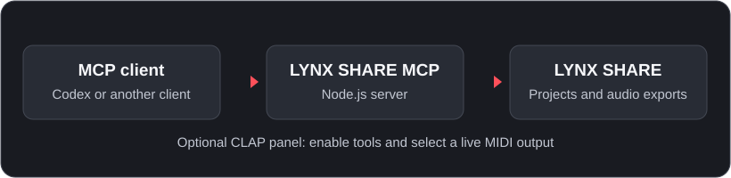

# Install LYNX MCP on Windows



## 1. Download and extract

Install [Node.js](https://nodejs.org/) 20 or newer and [LYNX SHARE](https://github.com/Ka1-S/LYNX-SHARE/releases). Download the Windows x64 ZIP from the [latest LYNX MCP release](../../../releases/latest). Extract it into a folder you can keep, such as a folder named **LYNX-MCP** in Documents.

## 2. Connect Codex

Open PowerShell in the extracted folder. Run the following and paste the full path to your own `LYNX.exe` when prompted.

```powershell
$lynx = (Read-Host 'Full path to LYNX.exe').Trim('"')
if (!(Test-Path -LiteralPath $lynx -PathType Leaf)) { throw 'LYNX.exe was not found' }
$server = (Resolve-Path -LiteralPath .\server.mjs).Path
codex mcp add lynx-share --env "LYNX_EXE=$lynx" -- node $server
```

If `lynx-share` is already registered, run `codex mcp remove lynx-share` before re-registering it. Restart Codex and ask it to call `lynx_status`. For other MCP clients, use stdio transport, command `node`, the full path to `server.mjs` as its argument, and set `LYNX_EXE` in the server environment.

## 3. Optional LYNX panel

Copy `LYNX-Project-Utility.clap` from the extracted release into `%APPDATA%\LYNX\Plugins`. Rescan plugins in LYNX. Add **LYNX MCP** from **Instruments** in the Channel Rack or **Effects** in the Mixer, then open its editor. Close LYNX before replacing a previous CLAP build.

**MCP enabled** controls tool calls. The **MIDI output** dropdown chooses the default for live tools. The panel finds the executable automatically when hosted by LYNX.exe. For a separate plugin host process, set the Windows user environment variable `LYNX_EXE` and relaunch LYNX if the panel cannot find it.

## 4. Optional live MIDI

1. Create a virtual MIDI loopback with an output that routes to a LYNX input.
2. In LYNX **Settings → MIDI**, open **Controller profiles folder**. Ask the MCP client to run `lynx_create_controller_profile` and save `lynx-mcp.lynxctl` there.
3. Refresh the device list, enable the loopback input, and choose **LYNX MCP (user)** as its controller type.
4. Select the matching output in the panel. Ask your client to test playback on an open project.

If Windows only lists Microsoft GS Wavetable Synth, project creation, editing, and exports still work. Live controls need a loopback input.

